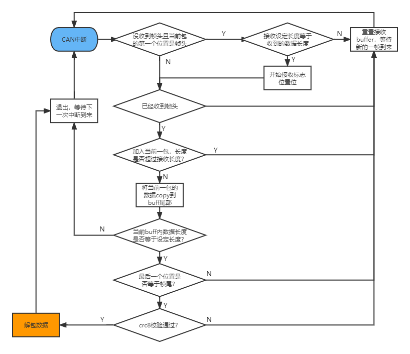

# can_comm

<p align='right'>neozng1@hnu.edu.cn</p>

## 当前 H723 双板通信实现

已采用 `dual-board_communication_demo_A` 的分包协议及可靠通信机制，底层使用 FDCAN 专用恢复流程，不能覆盖为 BxCAN 驱动。

- 新应用使用 `CANCommReceive(instance, &data)`：在线检查、整包复制、清更新标志在同一短临界区执行。返回 1 表示最近完整有效包仍在线，不一定是本周期的新包；离线返回 0，调用者负责停机或清除旧状态。
- `CANCommIsOnline()`同时要求收过完整 CRC 正确包、控制器可用、Bus-Off 代次一致、通信 daemon 未超时。控制器恢复后仍需新完整包才能再次在线。
- 组包分片间隔达到 20 ms 或跨越 Bus-Off 时丢弃半包。
- 整个逻辑包共享 1 ms 发送等待预算；任何分片发送失败就停止该逻辑包。离线时每 100 ms 才尝试发送一次。
- `DaemonTask()`每 10 ms 调用 `CANServiceTask()`，FDCAN 轮询与错误中断配合维护 RUNNING / WAIT_RETRY / RECOVERING 状态，100 ms 重试、1000 ms 恢复超时。
- `can_bus_status[0].online`表示 CAN1 对端有效包在线；`state/tec/rec`和恢复计数描述物理总线状态，两者含义不同。
- `CANCommGet()`仅为旧接口，返回内部缓存指针，不能保证异步读取的一致性。下文旧范例涉及该接口时，应改为复制接口。

底盘发 `0x311`、收 `0x312`，命令 24 字节、反馈 65 字节；反馈中的完整 IMU 数据占偏移 0～39，偏移 49 为共用的四字节 `App_Fault_s fault`：电机离线位 `motor_offline_flags`、通信故障 `comm_fault_flags`、IMU 故障 `imu_fault_flags`、控制输入故障 `control_fault_flags` 依次位于 49～52，速度字段偏移为 53/57/61。有效数据缓存上限为 65 字节，附加 4 字节协议开销后为 69 字节，分成 9 帧经典 CAN 发送，最后一帧 5 字节。本云台板已同步缓存上限和 `robot_def.h` 的布局，云台板沿用 CAN1 发 `0x312`、收 `0x311`，与底盘板的 CAN3 连接；控制器编号不必相同，两端位速率必须一致。旧反馈布局无法直接兼容。只有线上 payload 使用 pack(1)，通信内部实例使用自然对齐。

## 重要提醒

本工程保持 CubeMX 的 AutoRetransmission=DISABLE。出现丢包时先检查两侧结构长度、CAN 位时序、总线负载及接线，并观察收发错误计数；恢复逻辑见上述 FDCAN 实现。

## 总览和封装说明

CAN comm是用于CAN多机通信的模块。你不需要关心实现的协议，**只需要传入你想发送/接收的结构体的长度**（通过`sizeof()`获取）即可。一个完整逻辑包的有效数据长度目前限制为 65 字节，由 `can_comm.h` 中的 `CAN_COMM_MAX_BUFFSIZE` 定义；加上帧头、长度、CRC8 和帧尾共 4 字节后，发送和接收缓存各为 69 字节。底层经典 CAN 单帧仍最多 8 字节，由模块完成分包和重组。注意CAN的负载以及使用此模块的发送频率，否则可能造成堵塞。

## 代码结构

.h中放置的是数据定义和外部接口，以及协议的定义和宏，.c中包含一些私有函数。

## 外部接口

```c
CANCommInstance *CANCommInit(CANComm_Init_Config_s* comm_config);
void CANCommSend(CANCommInstance *instance, uint8_t *data);
uint8_t CANCommReceive(CANCommInstance *instance, void *data);
void *CANCommGet(CANCommInstance *instance);
uint8_t CANCommIsOnline(CANCommInstance *instance);
```

第一个函数将会初始化一个CANComm实例，返回其指针。使用CANComm进行通信的应用应该保存返回的指针。初始化需要传入一个初始化结构体。请在应用初始化的时候调用该函数。推荐的结构体配置方式如下：

```c
/* 初始化结构体的定义 */
typedef struct
{
    can_instance_config_s can_config;
    uint8_t send_data_len; //发送数据长度
    uint8_t recv_data_len; //接收数据长度,两者请用sizeof获取
} CANComm_Init_Config_s;

CANComm_Init_Config_s cconfig = {
  .can_config = {
            .can_handle=&hcan1,
            .tx_id=0x02,
            .rx_id=0x03},
  .send_data_len = sizeof(your_data_structure),
  .recv_data_len = sizeof(recv_data_structure)
};
```

第二个函数将会通过CAN发送一帧数据。这里的“帧”不是CAN的一帧报文，而是你使用的数据。在CANComm初始化的时候，使用sizeof获得你要发送的数据的长度。调用此函数时，将你的数据结构或数据cast成`u8`类型的指针传入即可。==**特别注意，你的结构体需要使用预编译指令`#pragma pack(1)`以及`#pragma pack()`包裹**==，从而进行字节压缩而不进行字节对齐，如：

```c
#pragma pack(1)
typedef struct
{
    uint8_t aa;
    float bb;
    double cc;
    uint16_t dd;
} some_struct;
#pragma pack()
```

只有这样，这个结构体才不会进行padding扩充字节实现字节对齐。你可以尝试一下，如果不使用pack处理，上面的结构体将会占据18个字节以上的空间；开启pack后，会降低至15。更多关于字节对齐的内容，自行查询。

> 后期可能更新字节对齐和内存访问相关的教程。

`CANCommGet()`是获取来自CANComm接收到的数据的接口，返回值为一个void类型指针，你需要通过**强制类型转换**将其变为你设定的接收类型指针，然后就可以访问其数据了。

## 私有函数和变量

```c
static CANCommInstance *can_comm_instance[MX_CAN_COMM_COUNT] = {NULL};
static uint8_t idx; 
static void CANCommResetRx(CANCommInstance *ins);
static void CANCommRxCallback(can_instance *_instance);
```

第一个指针数组保存所有的can comm实例，从而在callback中区分不同实例。idx是初始化使用的索引，用于确定每个can comm实例指针存放的位置。

`CANCommResetRx()`在`CANCommRxCallback()`中多次被调用，用于清空接收缓冲区。

`CANCommRxCallback()`是CAN comm初始化can实例时的回调函数，用于can接收中断，进行协议解析。

## 使用范例

例如，这里要发送的数据是一个float，接收的数据是如下的`struct`，**==注意要使用pack==**：

```c
#pragma pack(1)
struct test
{
 float aa;
 float bb;
 float cc;
 uint16_t dd;
};
#pragma pack()
```

初始化时设置如下：

```c
CANComm_Init_Config_s cconfig = {
  .can_config = {
            .can_handle=&hcan1,
            .tx_id=0x02,
            .rx_id=0x03},
  .send_data_len = sizeof(float),
  .recv_data_len = sizeof(struct test)
};
CANCommInstance* ins = CANCommInit(&cconfig);
```

通过`CANCommGet()`并使用强制类型转换获得接收到的数据指针：

```c
struct test* data_ptr=(struct test*)CANCommGet(ins)
```

发送通过`CANCommSend()`，建议使用强制类型转换：

```c
float tx=114.514;
CANCommSend(ins, (uint8_t*)&tx);
```

## 接收解析流程

CAN comm的通信协议如下：

| 帧头        | 数据长度 | 数据             | crc8校验 | 帧尾        |
| ----------- | -------- | ---------------- | -------- | ----------- |
| 's'（0x73） | 0~255    | 最大65（可修改） | 校验码   | 'e'（0x65） |
| 1-byte      | 1-byte   | n-byte           | 1-byte   | 1-byte      |

接收的流程见代码注释。

流程图如下：
